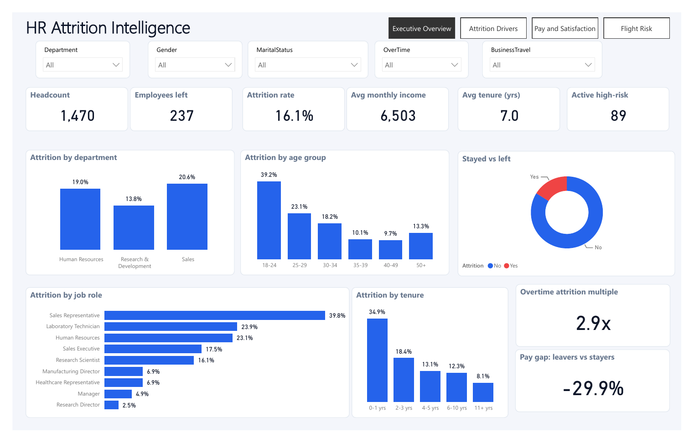
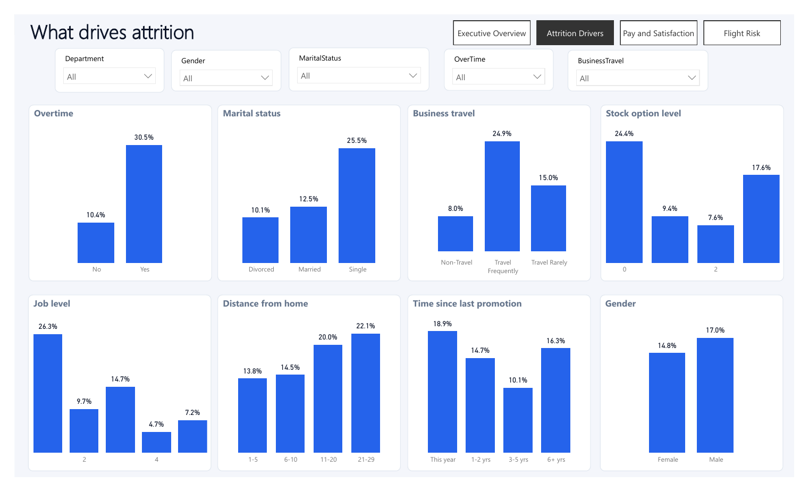
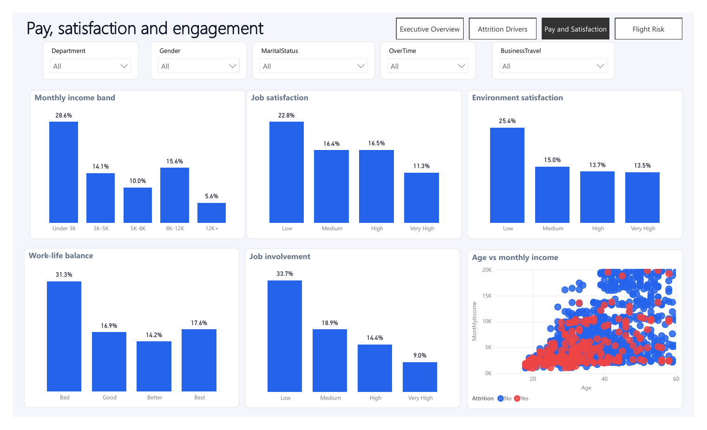
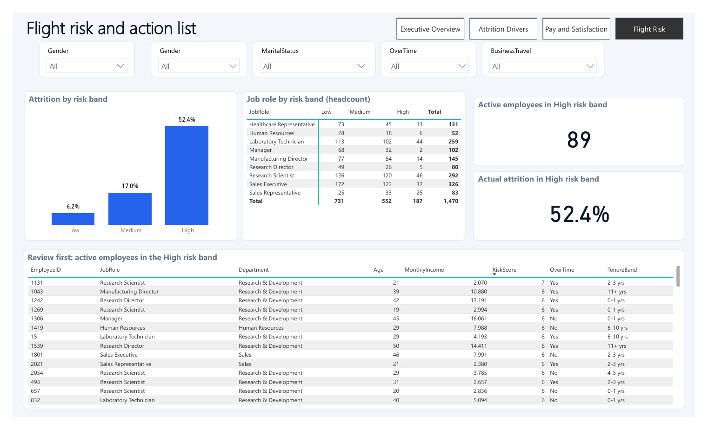

<div align="center">



<br/>


**An interactive Power BI dashboard that shows who leaves, why they leave, and who HR should talk to first.**

[Preview](#-preview) | [Key insights](#-key-insights) | [Dashboard pages](#-dashboard-pages) | [Run it](#-run-it-locally) | [Author](#-author)

</div>

<br/>

## At a glance



<br/>

## 📸 Preview

<p align="center">
  
</p>

---

## 💡 Key insights



<br/>

| | Finding | What the dashboard shows |
|---|---|---|
| 🔴 | **Overall attrition** | 237 of 1,470 employees left, a **16.1%** attrition rate |
| ⏰ | **Overtime is the loudest warning sign** | 30.5% attrition with overtime vs 10.4% without, a **2.9x** gap |
| 🧑‍💼 | **Sales Representatives churn the most** | 39.8% of them left, while Research Directors sit at just 2.5% |
| 🌱 | **Young and new employees leave first** | 39.2% in the 18-24 age group and 34.9% in the first year, falling to 8.1% after 11+ years |
| 💸 | **Pay matters** | Leavers earned **29.9% less** than stayers on average. The under-3K income band loses 28.6% vs 5.6% in the 12K+ band |
| 🎯 | **Engagement and balance** | Low job involvement hits 33.7% attrition and bad work-life balance hits 31.3% |
| ✈️ | **Frequent travel and marital status** | Frequent travellers lose 24.9% vs 8.0% for non-travel. Single employees lose 25.5% vs 10.1% for divorced |
| 🚨 | **Flight risk works** | The High risk band saw **52.4%** actual attrition vs 6.2% in the Low band, and **89** active employees sit in High risk today |

---

## 🗂 Dashboard pages

The report has 4 pages. Use the buttons at the top right to switch between them. Every page has filters for Department, Gender, Marital Status, OverTime and Business Travel.

### 1. Executive Overview

The big picture in one screen: six KPI cards, then attrition by department, age group, job role and tenure, plus a stayed vs left donut, the overtime attrition multiple and the pay gap between leavers and stayers.

<p align="center">
  
</p>

### 2. Attrition Drivers

Breaks attrition down by the factors that might explain it: overtime, marital status, business travel, stock option level, job level, distance from home, time since last promotion and gender.

<p align="center">
  
</p>

### 3. Pay and Satisfaction

Looks at the money and the mood: monthly income bands, job satisfaction, environment satisfaction, work-life balance, job involvement, and an age vs monthly income scatter split by who stayed and who left.

<p align="center">
  
</p>

### 4. Flight Risk

Turns the analysis into action. Employees get a risk score and a Low, Medium or High band. The page shows attrition by band, a job role by risk band matrix, and a ranked **"Review first"** list of active employees in the High band with role, department, age, income, risk score, overtime and tenure band.

<p align="center">
  
</p>

<!-- TODO: add 1-2 lines on how RiskScore is calculated (which factors, how bands are cut). -->

---

## ✨ Features

- 4 linked report pages with button navigation
- 5 slicers (Department, Gender, Marital Status, OverTime, Business Travel) that filter every visual
- KPI cards for headcount, exits, attrition rate, income, tenure and high-risk headcount
- Consistent colour logic: blue for metrics, red for attrition and risk
- An action list HR can use right away, not just charts

## 🧰 Tech stack

| Tool | Used for |
|---|---|
| **Power BI Desktop** | Report design, visuals, slicers, navigation |
| **IBM HR Analytics dataset (CSV)** | Source data, 1,470 employee records |

## 📁 Project structure

```
hr-attrition-powerbi-dashboard/
├── README.md
├── HR_Attrition_Dashboard.pbix        # the Power BI report
├── data/
│   └── WA_Fn-UseC_-HR-Employee-Attrition.csv
├── assets/                            # animated graphics used in this README
│   ├── banner.svg
│   ├── kpi-strip.svg
│   └── top-roles.svg
├── images/                            # dashboard screenshots
│   ├── 01-executive-overview.png
│   ├── 02-attrition-drivers.png
│   ├── 03-pay-and-satisfaction.png
│   └── 04-flight-risk.png
├── docs/
│   └── hr-attrition-powerbi-dashboard.pdf   # full export of all 4 pages
└── .gitignore
```

## 🚀 Run it locally

1. **Download** this repo (green **Code** button, then **Download ZIP**) or clone it.
2. **Install** [Power BI Desktop](https://powerbi.microsoft.com/desktop/) (free, Windows).
3. **Open** `HR_Attrition_Dashboard.pbix`.
4. If Power BI asks for the data, point it to `data/WA_Fn-UseC_-HR-Employee-Attrition.csv`.

## 📊 About the dataset

The data is the IBM HR Analytics Employee Attrition sample dataset (`WA_Fn-UseC_-HR-Employee-Attrition.csv`). It was created by IBM data scientists for learning, so the findings show how the analysis works, not the numbers of a real company.

## 🎓 Skills shown in this project

Dashboard design and layout, KPI definition, interactive filtering, data storytelling, and turning analysis into a clear action list for HR.

---

## 👤 Author

**Lakshay Gupta** | Aspiring Data Analyst, Delhi, India

[](https://github.com/LoG1604)
[](https://linkedin.com/in/lakshay-gupta-17b7ba244)
[](mailto:lakshayguptabsr@gmail.com)

<div align="center">

If this project helped you, a ⭐ on the repo is appreciated.

</div>
